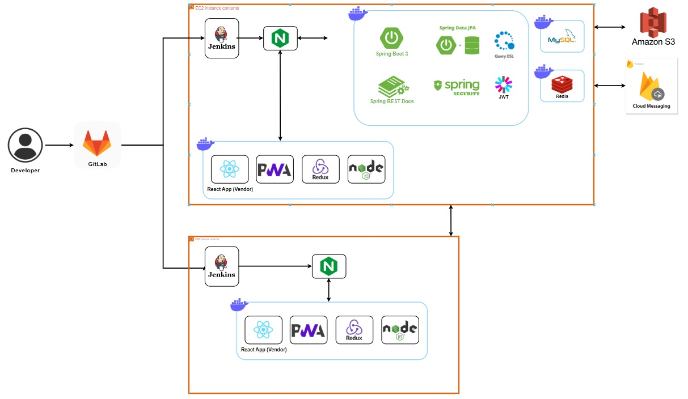

# 당근트럭
### 푸드트럭 주문 및 영업 관리 서비스
### FoodTruck ~

<br>

## Team 👨‍👩‍👦‍👦
<table align="center">
    <tr align="center">
        <td><a href="https://github.com/DongHyun22">
            <br />
            <sub><b>김동현</b></sub></a>
        </td>
        <td align="left">
            - Spring <br>
            - Server & CI/CD
        </td>
        <td ><a href="https://github.com/gunhoo">
            <br />
            <sub><b>박건후</b></sub></a>
        </td>
        <td align="left">
            - Spring <br>
            - Database
        </td>
        <td><a href="https://github.com/parkeg1223">
            <br />
            <sub><b>박은규</b></sub></a>
        </td>
        <td align="left">
            - Spring <br>
            - Database
        </td>
    </tr>
    <tr align="center">
        <td><a href="https://github.com/yjh910">
            <br />
            <sub><b>양진형</b></sub></a>
        </td>
        <td align="left">
            - Spring <br>
            - Database
        </td>
        </td>
            <td><a href="https://github.com/">
            <br />
            <sub><b>이정찬</b></sub></a>
        </td>
        <td align="left">
            - React <br>
            - UI/UX
        </td>
        <td><a href="https://github.com/">
            <br />
            <sub><b>최영환</b></sub></a>
        </td>
        <td align="left">
            - Spring <br>
            - Database
        </td>
    </tr>
</table>


<br>

## 개요 Introduction 📁
``` 
당근트럭은 사용자들이 푸드트럭에 보다 손쉽게 접근할 수 있게 하고, 사업자들에게는 푸드트럭의 효율적인 운영을 가능하게 하는 것이 목표입니다.
```

<br>


## 개발 기간 Duration 📅

2023.10.09. - 2023.11.17. (6 weeks)

## 주요 기능 Main Function 🧰
### 사용자
#### 지도에 영업중인 푸드트럭 조회

#### 푸드트럭 목록 조회

#### 푸드트럭 상세조회( 메뉴, 가게정보, 리뷰)

#### 푸드트럭 찜

#### 장바구니 메뉴 추가

#### 장바구니 메뉴 수정

#### 장바구니 메뉴 삭제

#### 주문하기 페이지 조회

#### 결제

#### 유저 주문내역 조회


#### 유저 리뷰조회


#### 수요조사


### 사업자
#### 푸드트럭 등록

- 사업자 회원은 푸드트럭을 등록할 수 있습니다.
- 푸드트럭 이름, 사진, 카테고리, 소갯말 등 푸드트럭 정보를 입력하여 등록합니다.
- 푸드트럭은 사업자당 1대 이상 등록할 수 있습니다.

#### 푸드트럭 수정

- 사업자는 스케줄을 변경할 수 있습니다.
- 요일별로 영업 시작 시간과 종료 시간을 설정할 수 있습니다.
- 지도를 드래그 하여 영업 위치를 변경할 수 있습니다.


- 사업자는 푸드트럭 관리 페이지에서 메뉴를 등록/삭제할 수 있습니다.
- 메뉴 이름, 사진, 가격, 설명을 입력하여 등록합니다.
- 한번에 여러 메뉴를 등록할 수 있습니다.


- 사업자는 푸드트럭 관리 페이지에서 작성된 리뷰들을 확인할 수 있습니다.
- 리뷰 작성자 닉네임, 별점, 사진, 내용을 확인할 수 있습니다.

#### 영업시작

- 사업자는 영업을 시작할 수 있습니다.
- 지도에 표시된 마커와 주소로 영업 시작 위치를 확인할 수 있습니다.
- 판매할 메뉴들을 확인하고, 판매하지 않을 메뉴는 제외할 수 있습니다.
- 영업 시작시 영업 관리 페이지로 이동합니다.

#### 주문 확인 / 수락 / 거절

- 사업자는 영업중 주문을 확인하고 수락하거나 거절할 수 있습니다.
- 주문자의 닉네임, 연락처, 주문 일시, 주문 메뉴를 확인할 수 있습니다.
- 예상 대기 시간을 입력한 뒤 주문을 수락할 수 있습니다.
- 준비가 완료되면 준비완료 버튼을 눌러 해당 주문을 완료 처리할 수 있습니다.

#### 영업종료

- 사업자는 영업이 완료되면 영업을 종료할 수 있습니다.
- 영업 종료 시 해당 푸드트럭의 최근 영업일을 해당 영업의 영업 종료일로 갱신합니다.

#### 매출통계확인

- 사업자는 종료된 영업들의 통계를 확인할 수 있습니다.
- 통계는 영업별, 주별, 월별로 확인할 수 있습니다.
- 리스트에선 영업 일자, 시간, 매출액 등을 조회할 수 있으며, 각 아이템을 선택하면 상세 정보를 확인할 수 있습니다.
- 영업별 통계는 메뉴별, 시간대별 매출을 확인할 수 있습니다.
- 주별, 월별 통계는 메뉴별, 시간대별, 요일별 매출을 확인할 수 있습니다.

#### 수요조사확인

- 사업자는 상권분석 페이지에서 수요조사 결과를 확인할 수 있습니다.
- 행정동을 선택하여 해당 행정동의 수요조사 내용을 확인할 수 있습니다.
- 수요가 많은 카테고리 순으로 수요조사가 몇 건 있는지 확인할 수 있습니다.
- 카테고리를 선택하면 해당 카테고리에 작성된 수요조사의 상세 내용을 확인할 수 있습니다.

#### 상권분석확인

- 사업자는 상권분석 페이지에서 특정 업종의 현황을 확인할 수 있습니다.
- 현재 위치 기준으로 1km 반경 내, 동일 행정동 내에 선택한 업종의 가게가 얼마나 있는지 확인할 수 있습니다.
- 1km 반경 내에 있는 가게는 마커로 표시하여 보여줍니다.

## 주요 기술 Tech Stack 💡

### 시스템 아키텍쳐
- 시스템 아키텍쳐 이미지
  

### API
[당근트럭 REST API 문서](./exec/REST_Docs.pdf)

### Tool 
```
- Project: Jira & Git & Notion
- Desgin: Figma
- Server: Amazon EC2
- CI/CD: Jenkins
```

### Spring structure
```
├─api
│  ├─controller
│  │  ├─address
│  │  │  └─response
│  │  ├─analysis
│  │  │  └─response
│  │  ├─cart
│  │  │  ├─request
│  │  │  └─response
│  │  ├─docs
│  │  ├─foodtruck
│  │  │  ├─request
│  │  │  └─response
│  │  ├─member
│  │  │  ├─request
│  │  │  └─response
│  │  ├─menu
│  │  │  ├─request
│  │  │  └─response
│  │  ├─order
│  │  │  ├─request
│  │  │  └─response
│  │  ├─payment
│  │  ├─review
│  │  │  ├─request
│  │  │  └─response
│  │  ├─sale
│  │  │  ├─request
│  │  │  └─response
│  │  ├─schedule
│  │  │  ├─request
│  │  │  └─response
│  │  ├─statistics
│  │  │  └─response
│  │  └─survey
│  │      ├─request
│  │      └─response
│  └─service
│      ├─address
│      │  └─dto
│      ├─analysis
│      │  └─dto
│      ├─cart
│      │  └─dto
│      ├─fcm
│      │  └─dto
│      ├─foodtruck
│      │  └─dto
│      ├─geocoding
│      │  └─dto
│      │      └─gc
│      ├─member
│      │  ├─command
│      │  ├─dto
│      │  ├─error
│      │  └─query
│      ├─menu
│      │  └─dto
│      ├─order
│      │  └─dto
│      ├─review
│      │  └─dto
│      ├─sale
│      │  └─dto
│      ├─schedule
│      │  └─dto
│      ├─statistics
│      │  └─dto
│      │      ├─details
│      │      └─list
│      └─survey
│          └─dto
├─client
│  ├─mail
│  └─Sse
├─config
├─domain
│  ├─address
│  │  └─repository
│  ├─adong
│  │  └─repository
│  ├─cart
│  │  └─repository
│  ├─foodtruck
│  │  └─repository
│  │      ├─command
│  │      ├─dto
│  │      └─query
│  ├─member
│  │  └─repository
│  │      ├─command
│  │      └─query
│  ├─menu
│  │  └─repository
│  │      ├─command
│  │      └─query
│  ├─order
│  │  └─repository
│  │      ├─command
│  │      └─query
│  ├─review
│  │  └─repository
│  ├─sale
│  │  └─repository
│  │      ├─command
│  │      └─query
│  └─survey
│      └─repository
├─file
└─security
```

### React structure (Client)
```
├─api
│  ├─foodtruck
│  └─member
├─assets
│  ├─fonts
│  ├─icons
│  └─imgs
├─components
│  ├─atoms
│  │  ├─BackHome
│  │  ├─BackSpace
│  │  ├─BigButton
│  │  ├─Button
│  │  ├─CartMenuItem
│  │  ├─CategoryListItem
│  │  ├─FoodTruckInfoItem
│  │  ├─FoodTruckListItem
│  │  ├─FoodTruckMenuItem
│  │  ├─FoodTruckReviewtem
│  │  ├─Input
│  │  ├─Map
│  │  ├─MenuOption
│  │  ├─MyReview
│  │  ├─NavbarItem
│  │  ├─OrderListItem
│  │  ├─ReviewListItem
│  │  ├─SearchBar
│  │  ├─ShoppingCartItem
│  │  └─Toggle
│  └─organisms
│      ├─AddMenuFrom
│      ├─CartMenu
│      ├─CategoryList
│      ├─FoodTruckInfo
│      ├─FoodTruckList
│      ├─FoodTruckMenu
│      ├─FoodTruckReview
│      ├─JoinForm
│      ├─LoginForm
│      ├─MyReviewsForm
│      ├─Navbar
│      ├─OrderListForm
│      ├─OrderReview
│      ├─RegisterSwitchButton
│      ├─RegistFoodTruckButton
│      ├─ReviewList
│      ├─StoreInfoForm
│      └─SwitchButton
├─hooks
├─pages
│  ├─CartOrderPage
│  ├─CartPage
│  ├─FoodTruckPage
│  ├─LoginPage
│  ├─MainPage
│  ├─MyInfoPage
│  ├─MyPage
│  └─SurveyPage
├─routes
├─slices
│  └─userSlice
├─store
└─styles
```

### React structure (Vendor)
```
├─api
│  ├─foodtruck
│  └─member
├─assets
│  ├─fonts
│  ├─icons
│  └─imgs
├─components
│  ├─atoms
│  │  ├─BackHome
│  │  ├─BackSpace
│  │  ├─BigButton
│  │  ├─Button
│  │  ├─ButtonOutline
│  │  ├─CategoryListItem
│  │  ├─FoodTruckInfoItem
│  │  ├─FoodTruckListItem
│  │  ├─FoodTruckMenuItem
│  │  ├─FoodTruckReviewtem
│  │  ├─Input
│  │  ├─InputChange
│  │  ├─Loading
│  │  ├─Map
│  │  ├─MenuOption
│  │  ├─MenuSelectorItem
│  │  ├─NavbarItem
│  │  ├─NothingHere
│  │  ├─OrderHistoryItem
│  │  ├─ReturnToSaleMain
│  │  ├─ScheduleMap
│  │  ├─SearchBar
│  │  ├─SelectedFoodTruck
│  │  ├─ShowDetail
│  │  ├─StatisticsCriteria
│  │  ├─StatisticsDateText
│  │  ├─StatisticsMonthItem
│  │  ├─StatisticsSalesItem
│  │  ├─StatisticsWeekItem
│  │  ├─SurveyDetailsItem
│  │  ├─SurveyListItem
│  │  ├─TitleText
│  │  ├─Toggle
│  │  ├─ToNextDate
│  │  ├─ToOrderDetail
│  │  ├─ToPrevDate
│  │  └─UnselectAddress
│  └─organisms
│      ├─AnalysisResult
│      ├─BusinessRegistration
│      ├─CategoryList
│      ├─FoodTruckInfo
│      ├─FoodTruckList
│      ├─FoodTruckMenu
│      ├─FoodTruckModifyForm
│      ├─FoodTruckRegistration
│      ├─FoodTruckReview
│      ├─FoodTruckSelector
│      ├─JoinForm
│      ├─LoginForm
│      ├─MenuSelector
│      ├─ModifyScheduleForm
│      ├─Navbar
│      ├─OrderDetailButton
│      ├─OrderHistoryList
│      ├─RegisterSwitchButton
│      ├─RegistFoodTruckButton
│      ├─SalesByDay
│      ├─SalesByHour
│      ├─SalesByMenu
│      ├─ScheduleForm
│      ├─SelectAddress
│      ├─StatisticsCriteriaBar
│      ├─StatisticsDateSelector
│      ├─StatisticsList
│      ├─SurveyList
│      ├─SwitchButton
│      └─VendorMainForm
├─hooks
├─pages
│  ├─AnalysisPage
│  ├─FoodMenuDetailModifyPage
│  ├─FoodMenuDetailPage
│  ├─FoodMenuModifyPage
│  ├─FoodTruckModifyPage
│  ├─FoodTruckPage
│  ├─LoginPage
│  ├─MainPage
│  ├─RegistrationPage
│  ├─SalePage
│  ├─SchedulePage
│  ├─StartSalePage
│  ├─StatisticsDetailPage
│  ├─StatisticsPage
│  └─SurveyPage
├─routes
├─slices
│  └─userSlice
├─store
└─styles
```

<!--

<br>

## 주요 기능 Main Function 🧰

### 메인페이지


- 최상단 검색 탭을 통해 식재료와 레시피를 검색할 수 있다.
- 식재료 분류를 확인하고 해당 식재료들을 확인할 수 있다.
- 오늘의 채움 베스트 상품들을 확인할 수 있다.
- 사용자 맞춤형 상품들을 확인할 수 있다.
- 오늘의 최저가 식재료를 확인할 수 있다.

### 레시피
#### 레시피 목록


- 하단 네비게이션 바를 통해 레시피들을 확인할 수 있다.
- 아래로 스크롤하여 새로고침을 할 수 있다.
- 위로 스크롤하여 여러 레시피들을 확인할 수 있다.

#### 레시피 상세 보기


- 레시피 조리 방법에 대해 확인할 수 있다.
- 유튜브 영상을 확인할 수 있다.
- 관심있는 레시피에 좋아요를 할 수 있다.
- 유사 레시피를 확인할 수 있다.

### 식재료
#### 식재료 카테고리


- 하단 네비게이션 바를 통해 식재료 카테고리를 확인할 수 있다.
- 원하는 분류를 선택하면 해당 카테고리에 해당하는 식재료들을 보여준다.
- '알림설정'을 통해 가격이 크게 하락하면 앱 알림을 받을 수 있다.
- '관심없음'을 통해 해당 식재료를 추천하지 않도록 할 수 있다.

#### 식재료 상세조회


- 식재료 상세조회에서 상품, 가격정보, 레시피를 확인할 수 있다.
- 가격정보 탭에서는 최근 3개월 가격 변동 그래프를 확인하고 추천상품 사이트에 접속할 수 있다.
- 레시피 탭에서는 해당 식재료가 포함된 레시피들을 확인할 수 있다.

### 검색


- 채움만의 추천레시피를 확인할 수 있다.
- 검색에 검색어를 입력하면 관련 식재료와 레시피 정보를 확인할 수 있다.

### 회원


- 이메일 인증을 통해 회원가입을 할 수 있다.
- 회원가입 시 성별, 연령, 알러지 여부, 채식 여부를 입력할 수 있다.


- 이메일을 통해 로그인을 할 수 있다.
- 네이버를 통해 로그인을 할 수 있다.
- 카카오를 통해 로그인을 할 수 있다.


- 내가 좋아요 한 레시피를 확인할 수 있다.
- 내가 좋아요 한 식재료를 확인할 수 있다. 
- 회원정보 수정을 통해 채식 및 알러지 여부를 변경할 수 있다.
- 비밀번호 변경 / 로그아웃 / 회원탈퇴를 할 수 있다.


<br>

## 주요 기술 Tech Stack 💡

### 시스템 아키텍쳐


### Tool 
```
- Project: Jira & Git & Notion
- Desgin: Figma
- Server: Amazon EC2
- APP: Flutter
- Recommend: Django
- CI/CD: Jenkins
```


### Version

```
BackEnd
 ├── Spring
 │    ├── Java: OpenJDK 11 
 │    ├── SpringBoot: 2.7.13
 │    │    ├── Gradle
 │    │    └── JPA
 │    ├── Spring Security
 │    │    └── JWT
 │    ├── Swagger 3.0
 │    ├── Naver Mail
 │    └── Social Login
 │         ├── Naver
 │         └── Kakao
 │
 ├── Django
 │    ├── Python: 3.11.4
 │    └── Django: 4.1.7 
 │
 └── Database
      ├── MariaDB 10.11.4
      └── Redis 3.0.504

FrontEnd
 ├── Dart 3.1.0
 └── Flutter 3.13.1
```

<br>

## 개발 가이드 Development Guild 

### [Convention](https://half-yamamomo-2ac.notion.site/Convention-f46b96c0a223459da1a034a20d4bd1f6?pvs=4)

### API


### ERD


### 가이드 🗞
[프로젝트 매뉴얼(포팅매뉴얼)](./exec/채움_포팅메뉴얼.pdf)  
[DumpSQL](./exec/dump.sql)  

<br>

## 폴더 구조 Directory structure 💡

### Spring structure
```
├─allergy
│  ├─controller
│  ├─entity
│  │  ├─composite
│  │  └─single
│  ├─id
│  ├─repository
│  └─service
├─category
│  ├─controller
│  ├─dto
│  ├─entity
│  ├─repository
│  ├─service
│  └─vo
├─chaeum
├─config
├─exception
├─ingredient
│  ├─controller
│  ├─converter
│  ├─dto
│  ├─entity
│  │  ├─composite
│  │  ├─id
│  │  └─single
│  ├─id
│  ├─repository
│  ├─service
│  └─vo
├─item
│  ├─controller
│  ├─converter
│  ├─dto
│  ├─entity
│  │  ├─composite
│  │  └─single
│  ├─id
│  ├─repository
│  ├─service
│  └─vo
├─jwt
│  └─service
├─mail
├─notification
│  ├─entity
│  │  └─composite
│  ├─id
│  ├─repository
│  └─service
├─recipe
│  ├─controller
│  ├─dto
│  ├─entity
│  │  ├─composite
│  │  └─single
│  ├─id
│  ├─repository
│  └─service
├─search
│  ├─controller
│  ├─dto
│  └─service
└─user
    ├─controller
    ├─converter
    ├─dto
    ├─entity
    ├─repository
    ├─service
    ├─util
    └─vo
```

### Flutter structure
```
│  firebase_options.dart
│  main.dart
│
├─api
│      firebaseapi.dart
│
├─category
│      categorymain.dart
│
├─detail
│      detail.dart
│      detailrecipe.dart
│      pricechart.dart
│      priceinfo.dart
│      pricetable.dart
│      productlist.dart
│      profile.dart
│      recomproduct.dart
│
├─ingredients
│      ingrfavbtn.dart
│      ingrmain.dart
│
├─main
│      mainbest.dart
│      mainbody.dart
│      maincarousel.dart
│      maincategory.dart
│      mainmybest.dart
│      mainrowprice.dart
│      splash.dart
│
├─recipe
│      player.dart
│      recipedetail.dart
│      recipemain.dart
│      recipemainlist.dart
│      similarrecipe.dart
│
├─repeat
│      bottom.dart
│      needlogin.dart
│      search.dart
│
├─search
│      searchingr.dart
│      searchlist.dart
│      searchmain.dart
│      searchmainrecipe.dart
│      searchrecipe.dart
│      searchresult.dart
│
├─store
│      searchstore.dart
│      userstore.dart
│
├─user
│      addinfo.dart
│      fav_food.dart
│      fav_rec.dart
│      findpassword.dart
│      login.dart
│      mypage.dart
│      my_more_food.dart
│      my_more_rec.dart
│      pageapi.dart
│      signup.dart
│      signuptimer.dart
│
└─webview
        webview.dart
``` -->
